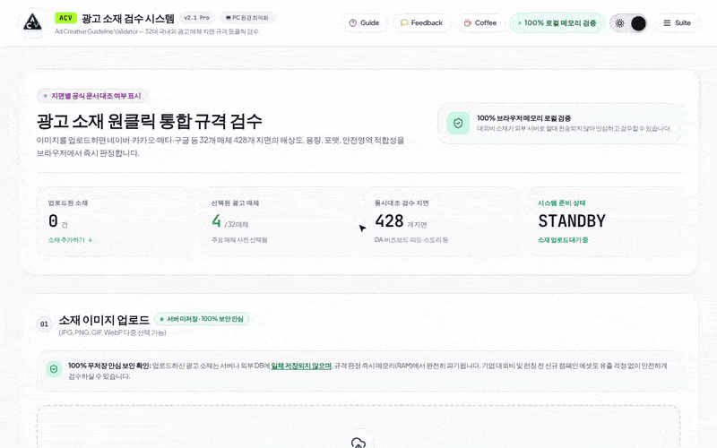

# 🖼️ 광고 소재 검수 시스템 (Ad Creative Validator Pro)

광고 소재(이미지 파일)를 업로드하면 **32개 국내외 광고 매체, 429개 세부 지면**의 규격(해상도·비율·용량·포맷·투명 배경) 적합 여부를 한 번에 검수하고 CSV 리포트(엑셀에서 열림)를 만들어 주는 도구입니다.

> Upload ad creatives and check them against 429 placement specs across 32 Korean and global ad platforms — entirely in your browser.

**👉 바로 사용하기: [ad-creative-validator.vercel.app](https://ad-creative-validator.vercel.app/)** · 설치·회원가입 없음 · 소재는 서버로 전송되지 않습니다

<p align="center">
  
</p>

<p align="center"><sub>폴더째 업로드 → 매체 자동 분류 → 검수 실행 → 폴더별 결과 리포트까지 모두 브라우저 안에서 진행됩니다.</sub></p>

## 🧭 3단계로 쓰기

1. **소재 업로드**: JPG·PNG·GIF·WebP 이미지를 여러 장 끌어다 놓거나, **캠페인 폴더를 통째로** 올립니다. 하위 폴더까지 읽고, `카카오/`, `META/`, `토스_피드/`처럼 폴더나 파일 이름에 매체명이 있으면 그 매체 규격으로만 자동 분류해 검수합니다. 이미지가 아닌 파일(문서, `.DS_Store` 등)은 빠집니다.
2. **매체 선택**: 기본으로 네이버·카카오·META·구글이 선택돼 있습니다. 매체 카드를 펼치면 세부 지면만 골라 검수할 수 있습니다.
3. **결과 확인**: 소재별 적합/반려 위험과 불일치 사유(예: `[Feed Vertical(4:5)] 비율 불일치`)를 폴더별로 걸러 보고, 폴더 경로·분류 근거가 담긴 CSV로 내려받아 공유합니다.

---

## 📮 규격 제보 (계정 없이)

ACV에 없는 크기의 소재는 결과에 **"규격 미등록"**으로 표시됩니다(반려 판정이 아닙니다). 매체 공식 가이드에 있는 규격이라면 그 자리에서 제보할 수 있습니다.

1. **제보**: "공식 규격이라면 제보하기"를 누르고 지면 이름·크기·용량·형식과 공식 가이드 주소 또는 **가이드 파일(PDF·PNG·JPG, 4MB까지)**을 넣습니다. GitHub 계정이 없어도 됩니다. 공식 가이드 주소는 매체별로 정한 공식 사이트만 받습니다(`frontend/src/data/officialSources.json`). 첨부 파일은 공개되지 않고 비공개 저장소(Vercel Blob)에 보관되며 90일 뒤 자동 삭제됩니다.
2. **접수**: 사이트가 대신 GitHub 이슈(`spec-report` 라벨)로 올립니다. 같은 규격이 이미 접수돼 있으면 그 이슈에 덧붙이고, 새 가이드 파일이 함께 오면 그 파일로 자동 점검을 다시 실행합니다.
3. **자동 점검**: GitHub Actions(`.github/workflows/spec-report.yml`)가 공식 가이드를 직접 받아 본문에서 크기·용량·투명 배경 문구를 찾고, 문서 날짜를 확인합니다. 찾으면 지면을 추가한 PR을 열고, 못 찾으면 이유를 이슈에 남기고 `needs-human` 라벨을 붙입니다. 12개월이 지난 문서는 "매체 확인 중"으로 추가합니다. 첨부 PDF에서 찾은 값은 공식 자료인지 증명할 수 없어 항상 "매체 확인 중"으로 추가하고, 이미지 첨부는 운영자가 직접 봅니다.
4. **반영**: 운영자가 PR의 근거를 확인하고 머지하면 Vercel이 배포합니다. 자동으로 머지되는 일은 없습니다.

## 🎯 지원 매체 (32개 매체 · 429개 세부 지면)

매체 이름 옆 숫자는 등록된 세부 지면 수입니다.

1. **포털 & SNS (6개 매체 · 119개 지면)**: 네이버 34, 카카오 19, META 11, 구글 35, 틱톡 10, 엑스(X) 10
2. **네트워크 DA & DSP (9개 매체 · 186개 지면)**: 크리테오 70, 몰로코 18, RTB House 17, 애피어 20, 데이블 8, 타불라 12, 에이스트레이더 15, 타겟픽 19, 리얼클릭 7
3. **커머스 & 금융 (4개 매체 · 36개 지면)**: 쿠팡 16, 토스 9, 당근 7, 원스토어 4
4. **리워드 & 앱테크 (4개 매체 · 35개 지면)**: 버즈빌 7, 애디슨 오퍼월 4, 시럽/OK캐쉬백 11, TNK팩토리 13
5. **글로벌 & 미디어 (9개 매체 · 53개 지면)**: 링크드인 7, 핀터레스트 3, 스냅챗 4, 레딧 7, 스포티파이 4, SOOP 4, 치지직 3, 카울리 10, 애드팝콘 11

### 매체별 주요 지면 (일부)

전체 지면 목록은 앱의 매체 카드를 펼치거나 `backend/specs/*.yaml`에서 볼 수 있습니다.

1. **애디슨 오퍼월 (Adison Offerwall)**:
   - 목록 배너 A타입 (720×360), 목록 배너 B타입 (144×144), 이벤트 상세 배너 (720×780)
2. **애피어 (Appier)**:
   - AI 쿼드/인터스티셜 (600×600, 900×1200), 모바일 전면 (640×960, 640×1136), 표준 배너 (300×250, 320×50), 네이티브
3. **버즈빌 (Buzzvil)**:
   - 잠금화면 세로 전면 (720×1280 9:16), 인앱 피드 와이드 배너 (720×360 2:1), 리워드 아이콘 (500×500 1:1), 네이티브 디스플레이 (1200×628)
4. **쿠팡 (Coupang Ads / Retail Media)**:
   - 메인 홈 와이드 배너 (1200×600 2:1), 골드박스 타임할인 (750×375 2:1), C.Native 상품 피드 (500×500 1:1), 기획전 헤더 (1080×360), 로켓배송 상단 (960×240)
5. **크리테오 (Criteo)**:
   - **표준 IAB 디스플레이 배너 13종**: 300×250, 728×90, 160×600, 300×600, 970×250, 970×90, 320×100, 320×50, 336×280, 120×600, 468×60, 250×250, 200×200
   - **플래그십 & 쇼케이스 빅배너 6종**: 플래그십 데스크톱 FS_300 (576×300), FS_200 (576×200), 쇼케이스 (310×500), 일반 쇼케이스 (270×390), 브랜디드 헤더 배경 (1242×300), 헤더 로고 (460×300)
   - **어댑티브 마스터 3종**: Square 1:1 (1200×1200), Landscape 1.91:1 (1200×628), Portrait 2:3 (800×1200)
   - **빅쿠폰 배너**: 300×250, 1200×628, 728×90, 300×600, 320×100, 320×50
   - **타이머 카운트다운 배너**: 300×250, 728×90, 300×600, 160×600, 1200×628, 320×100, 320×50
6. **당근 (Karrot Ads)**:
   - 피드 정방형 (1:1 1080×1080, 800×800), 피드 와이드 (1.91:1 1200×628), 피드 세로형 (4:5 800×1000), 중고거래 홈 상단 배너 (1000×500 2:1), 동네생활 스토리 (9:16 1080×1920)
7. **구글 (Google Ads)**:
   - PMax / 반응형 디스플레이 (1.91:1, 1:1, 4:5), Demand Gen (Shorts 9:16), GDN 업로드형 고정 배너 17종
8. **카카오모먼트 (Kakao Moment)**:
   - 카카오 비즈보드 (960×300, 투명 PNG 필수, 텍스트 20% 이하)
   - New 카카오 비즈보드 (확장/오브젝트형 960×300)
   - 카카오 DA (디스플레이 네이티브 2:1 1200×600, 1:1 500×500, 9:16 720×1280, 4:5 800×1000)
   - 카카오톡 채널 메시지 (와이드형 800×400 2:1, 기본형 800×600 4:3, 캐러셀 800×800 1:1)
   - 카카오페이지 / 다음 웹툰 배너 (720×300)
   - 카카오 포커스보드 (PC 배경 1504×336, 투명 오브젝트 314×300, 하위버전 1200×600)
9. **META (Facebook / Instagram)**:
   - 피드 4:5 (1080×1350), 피드 1:1, 가로형 1.91:1, 스토리·릴스 9:16 (1080×1920), 캐러셀 1:1
10. **몰로코 (Moloco)**:
    - 글로벌 모바일 DSP 네이티브 (1.91:1, 2:1, 1:1, 9:16, 3:4), 카카오 연동 비즈보드 (960×300)
11. **네이버 (Naver Ads / NOSP / GFA)**:
    - **NOSP 보장형 타임보드**: 고해상도 1660×260, 기본형 830×130
    - **NOSP 메인 롤링보드**: PC 메인 롤링보드 350×280, 모바일 롤링보드 750×400
    - **네이버 브랜드검색**: PC 브랜드존 300×150, 모바일 와이드 1000×500, 정방형 1000×1000
    - **네이버 밴드 (BAND)**: 피드 배너 정방형 1000×1000, 와이드 1200×600
    - **NOSP 모바일 스페셜DA**: 확장형 1250×520, 기본형 750×280
    - **NOSP 프리미엄 크라운**: 더블크라운 1250×520, 트리플크라운 1250×520
    - **스마트채널**: 750×280 (GFA), 750×200 / 1500×400 (NOSP)
    - **GFA 네이티브 피드**: 1:1 (1200×1200), 2:3 (1200×1800), 모바일 DA (1250×560)
12. **RTB House**:
    - 스태틱 배너 (300×250, 728×90, 300×600, 320×50, 320×100, 160×600)
    - 프로모보드 와이드 (1200×628), 정방형 (1200×1200)
    - 모바일 전면 인터스티셜 (320×480)
13. **틱톡 (TikTok)**:
    - 인피드 세로형 (9:16, 1080×1920), 정사각형 (1:1), 가로형 (16:9), Pangle 네트워크 배너
14. **토스 (Toss Ads)**:
    - 피드 정방형 (1:1 1080×1080), 피드 와이드 배너 (2:1 1200×600), 행운퀴즈 및 머니알림 (1.91:1 1200×628), 전면 인터스티셜 (9:16 1080×1920)
15. **엑스 (X / Twitter)**:
    - 단일 이미지 (1:1, 1.91:1), 몰입형 세로형 (9:16), 웹사이트 카드, 캐러셀

---

## ⚡ 주요 세부 지면 퀵 셀렉터 (원클릭 필터)

마케터와 디자이너가 실무에서 가장 많이 제작하는 세부 지면을 드롭다운에서 한 번에 선택하여 타 지면 규격과의 불필요한 충돌 없이 정밀 검수할 수 있습니다:

- `카카오 비즈보드` / `New 카카오 비즈보드` / `카카오 DA` / `카카오톡 채널 메시지`
- `네이버 DA` / `네이버 스마트채널` / `네이버 롤링보드` / `네이버 브랜드검색` / `네이버 밴드`
- `당근 (피드 광고)` / `당근 (홈 배너 / 스토리)`
- `토스 (피드 배너)` / `토스 (행운퀴즈·머니알림)`
- `쿠팡 (메인 홈 배너)` / `쿠팡 (C.Native 상품 피드)`
- `애디슨 오퍼월` / `구글 (Google)` / `META` / `틱톡 (TikTok)` / `몰로코 (Moloco)`
- `크리테오 (어댑티브)` / `크리테오 (빅쿠폰 배너)` / `크리테오 (타이머)`
- `RTB House (스태틱 배너)` / `RTB House (프로모보드)`
- `애피어 (Appier)` / `버즈빌 (Buzzvil)` / `엑스 (X / Twitter)`

---

## 📖 상단 메뉴 & 부가 기능

- **📖 사용 가이드**: 검수 시스템이 왜 필요한지, 실무에서 어떨 때 사용하면 좋은지(캠페인 라이브 전, 디자인 자가 검증, 리포트 공유 등)를 안내합니다.
- **💡 개발자에게 건의 / 규격 제보**: 새로운 광고 매체 지면 규격 추가 요청이나 변경된 가이드라인을 제보할 수 있습니다. 공개 사이트에서는 작성한 내용이 [GitHub Issues](https://github.com/Greycity1988/ad-creative-validator/issues) 작성 화면으로 넘어가며, 답변과 반영 상태도 그곳에서 확인합니다.
- **☕ 커피 후원하기**: 글로벌 공식 창작자 후원 플랫폼 [Ko-fi](https://ko-fi.com/greycity1988)를 통해 안전하고 간편하게 개발자에게 커피 한 잔을 후원하고 최신 광고 규격 연구를 응원할 수 있습니다. (당신의 $1가 개발자에게 큰 힘이 됩니다! ☕✨)

---

## ⚠️ 알려진 제한

- **규격 데이터는 수동으로 관리합니다.** 각 매체의 `last_verified_date`는 사람이 공식 가이드를 확인한 날짜이며, 공식 문서와 자동으로 대조하는 기능은 없습니다. 집행 전에는 매체 공식 가이드를 함께 확인하세요.
- **공식 문서 대조 현황 (2026-11 기준)**: 32개 매체 중 6개는 공식 문서와 대조 완료, 9개는 일부 대조, 17개는 아직 대조 전(참고용)입니다. 대조 상태는 앱의 매체 카드를 펼치면 매체별로 표시됩니다.
- **텍스트 비율은 자동 측정하지 않습니다.** 텍스트 비율 기준이 있는 지면에는 "직접 확인" 안내만 표시됩니다.
- **리포트는 CSV 파일입니다.** 엑셀에서 바로 열립니다(UTF-8 BOM).

---

## 🚀 로컬 실행 방법

검수는 전부 브라우저 안에서 이뤄지며 서버가 필요 없습니다.

```bash
cd frontend
npm install
npm run dev   # http://localhost:5173
```

## 🗂 규격 데이터 관리

- 원본: `backend/specs/*.yaml` (매체별 1파일)
- 화면용 데이터 생성: `pip install -r scripts/requirements.txt` 후 `npm run sync:specs` → `frontend/src/data/specsData.json`
- 무결성 점검: `npm run verify:specs`
- 공식 가이드 페이지 변경 감지: `npm run monitor:specs` (GitHub Actions 에서 주 1회 실행)

## 🌐 배포

Vercel 이 `frontend/` 를 빌드해 배포합니다. 설정과 보안 헤더는 `frontend/vercel.json` 에 있습니다.

---

## 📄 라이선스

[MIT](LICENSE) 라이선스입니다. 상업적 용도를 포함해 자유롭게 쓰고, 고치고, 배포할 수 있습니다.

Marketing Intelligence Suite의 일부이며, Owen O. Magnus가 만들었습니다.
